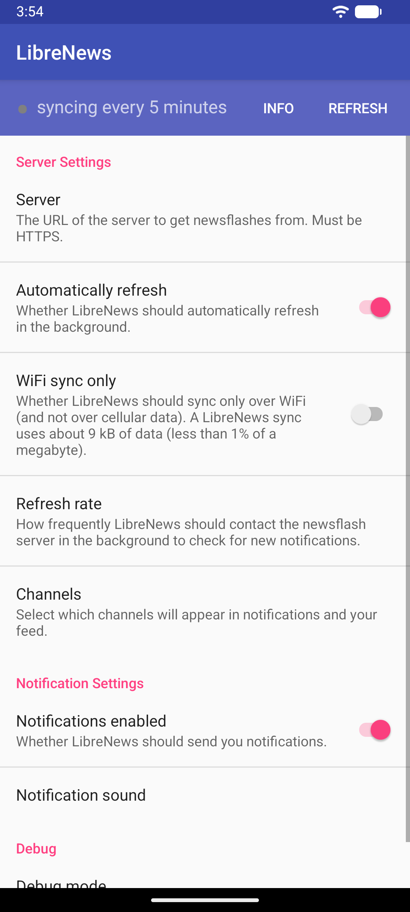
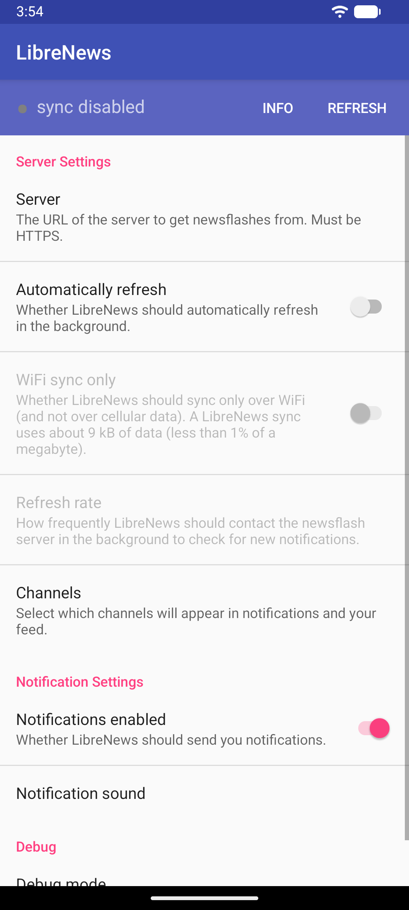
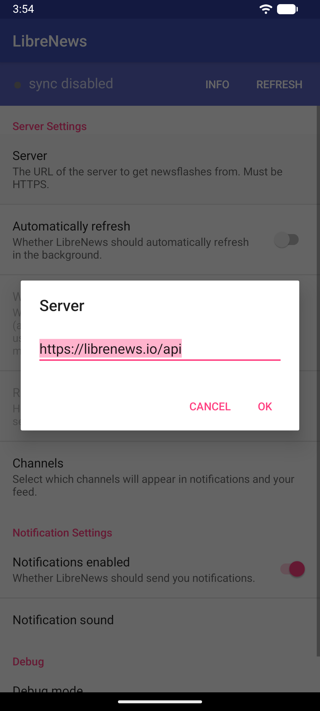
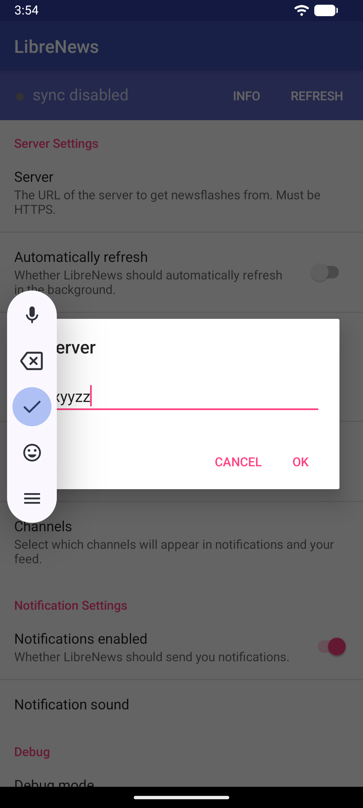
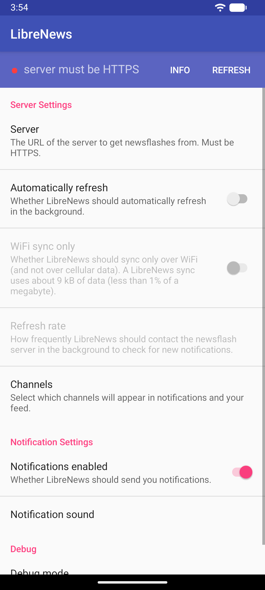
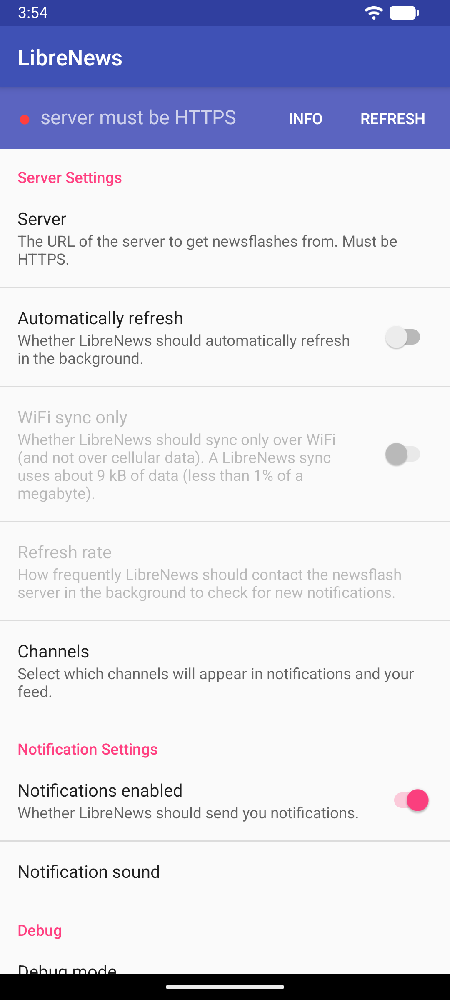

# LibreNews 1.4 实测报告

本报告由实际模拟器运行记录导出。复现的是已公开的历史缺陷，不是新发现的漏洞。

缺陷来源：[LibreNews Issue #22](https://github.com/milesmcc/LibreNews-Android/issues/22)。

报告编号：`android-20261015T063333772654Z`；状态：`completed`；捕获问题：**1**。

预期：无效服务器地址应显示错误，应用保持可用。实际：修改地址后点击刷新，目标应用发生数组越界崩溃。

应用：`app.librenews.io.librenews`，版本 `1.4`。
APK SHA-256：`80110343f0cbfa7fd8a99514425bf375a4dd2c36ae6b8f8c4ddf3d0ad8523d6a`。

## 操作步骤与截图

执行状态：`completed`。请求步骤 10，完成 10。

### 步骤 1：Dismiss the old-Android compatibility notice if present

状态：`completed`。


### 步骤 2：Dismiss the welcome page if present

状态：`completed`。



### 步骤 3：Disable automatic refresh

状态：`completed`。



### 步骤 4：Open the server address editor

状态：`completed`。



### 步骤 5：Replace the server address with xxyyzz

状态：`completed`。


### 步骤 6：Verify the entered server address is exactly xxyyzz

状态：`completed`。



### 步骤 7：Save the invalid address

状态：`completed`。



### 步骤 8：Check that the server status is visible before refreshing

状态：`completed`。



### 步骤 9：Refresh with an empty news list and invalid server

状态：`completed`。


### 步骤 10：Observe crash logs after refresh

状态：`completed`。


[机器可读操作记录](app-01-round-01/actions.json) · [可复测用例](app-01-round-01/scenario.json)

## 捕获到的崩溃

### BUG-001：JAVA_CRASH

```text
FATAL EXCEPTION: main
Process: app.librenews.io.librenews, PID: 6886
java.lang.ArrayIndexOutOfBoundsException: length=0; index=0
	at app.librenews.io.librenews.controllers.FlashManager.convertFlashesToOutputString(FlashManager.java:184)
	at app.librenews.io.librenews.controllers.FlashManager.writeFlashesToStorage(FlashManager.java:152)
	at app.librenews.io.librenews.controllers.FlashManager.clearPushedFlashes(FlashManager.java:200)
	at app.librenews.io.librenews.controllers.FlashManager.refresh(FlashManager.java:256)
	at app.librenews.io.librenews.views.MainFlashActivity$1.onClick(MainFlashActivity.java:67)
	at android.view.View.performClick(View.java:8241)
	at android.view.View.performClickInternal(View.java:8218)
	at android.view.View.-$$Nest$mperformClickInternal(View.java:0)
	at android.view.View$PerformClick.run(View.java:32182)
	at android.os.Handler.handleCallback(Handler.java:1095)
	at android.os.Handler.dispatchMessageImpl(Handler.java:135)
	at android.os.Handler.dispatchMessage(Handler.java:125)
	at android.os.Looper.loopOnce(Looper.java:296)
	at android.os.Looper.loop(Looper.java:397)
	at android.app.ActivityThread.main(ActivityThread.java:9523)
	at java.lang.reflect.Method.invoke(Native Method)
	at com.android.internal.os.RuntimeInit$MethodAndArgsCaller.run(RuntimeInit.java:575)
	at com.android.internal.os.ZygoteInit.main(ZygoteInit.java:939)
```

[完整错误栈](bugs/BUG-001/evidence.txt)

## 复测前置条件

服务器地址必须在同一次应用运行中发生变化。保留已有 xxyyzz 配置再输入相同地址，不一定会触发该分支。建议在专用模拟器使用 --reset-app-data 恢复首次安装状态，该参数会清除目标 App 的测试数据。

原始全设备日志保留在本机；此处发布目标包错误栈、实际步骤、原始 UI 树和截图。
